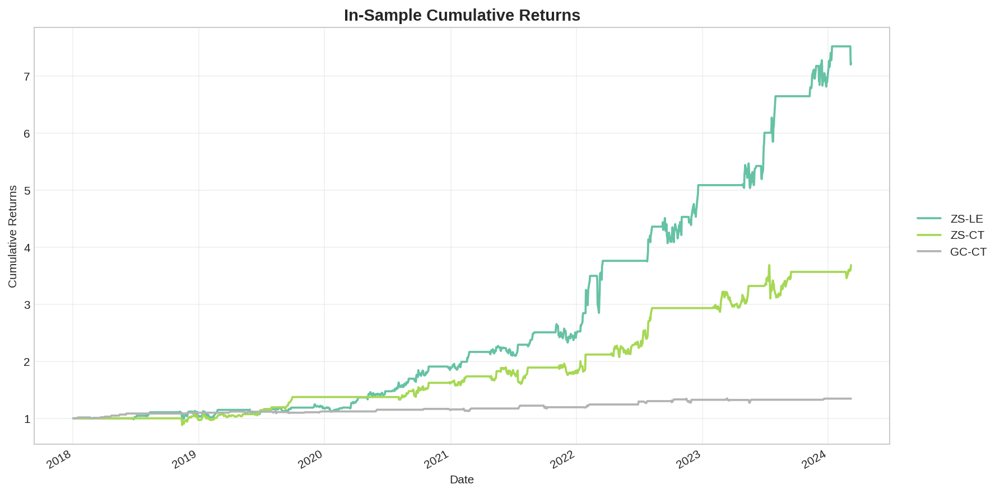
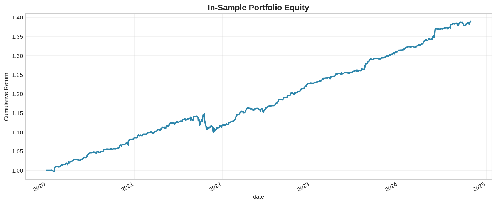
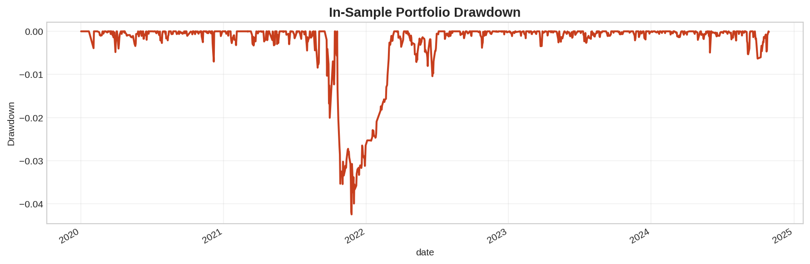

# kalman-pairs

Kalman Filter pairs trading on China futures.

## Data

Daily closes for 33 China futures contracts, 2020-01-02 → 2026-11-20.

```
A, AG, AL, AU, BU, C, CF, CS, CU, FG, HC, I, J, JD, JM, L, M, MA, NI, OI, P, PB, PP, RB, RM, RU, SF, SN, SR, TA, V, Y, ZN
```

Source: `china_futures_2020_2026.csv`

## Approach

1. Cointegration screen (Engle-Granger, p < 0.05)
2. Dynamic hedge ratio via Kalman Filter regression
3. Half-life of mean reversion as the rolling window for z-score
4. Signals: enter at ±2, exit at 0
5. Equal-weight portfolio of pairs with in-sample Sharpe > 0.5 and final equity > 1.105

### In-sample







## Notes

- No transaction costs or slippage modeled.
- Missing values are forward-filled.
- Cointegration and half-life should be monitored in live use.

## License

MIT
