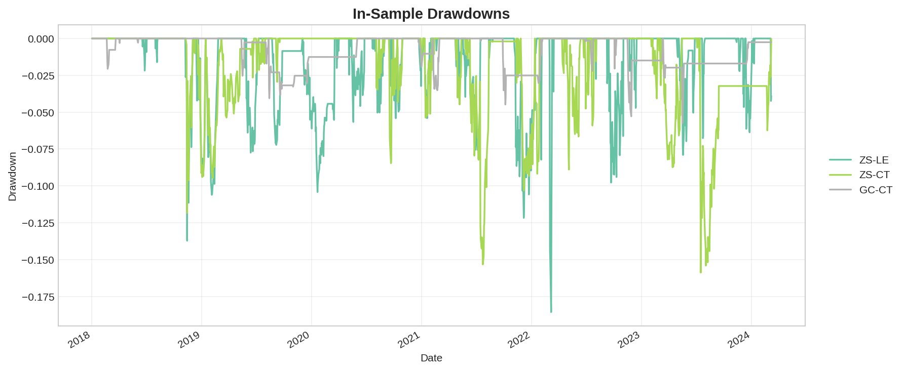
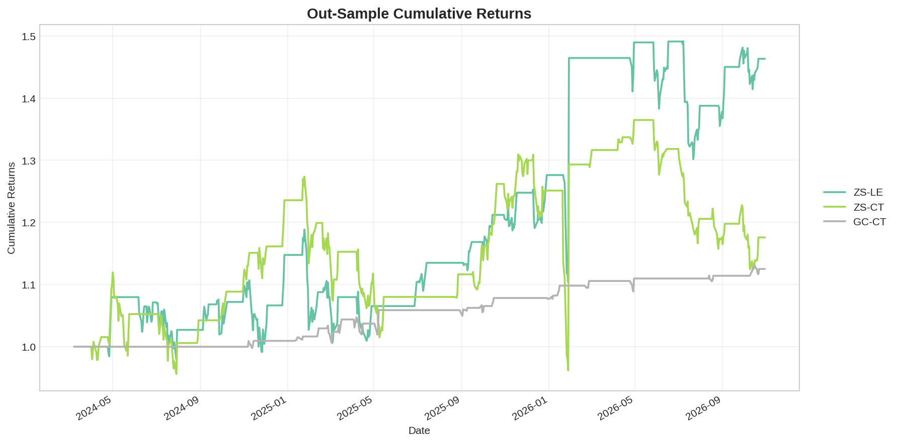
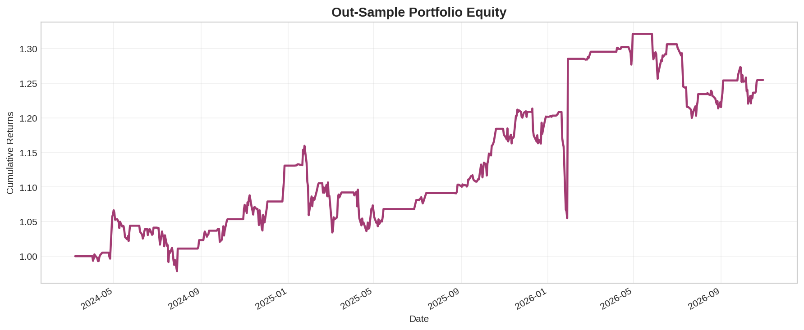
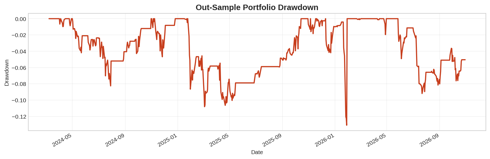

# kalman-pairs

Kalman Filter pairs trading — adapted from the [QuantInsti blog](https://blog.quantinsti.com/kalman-filter-techniques-statistical-arbitrage-china-futures-market-python/) on statistical arbitrage in China’s futures market.

## Original Tickers

The shared files used these 34 Chinese futures contracts:

```
M, SR, FG, CU, SN, NI, RM, AG, OI, CF, HC, J, I, TA, PB, AU, RB, V, JD, MA, TC, A, ZN, SF, P, C, BU, PP, JM, RU, AL, Y, CS, L
```

These exact contracts are **not available on yfinance**. The notebook uses the closest liquid commodity futures proxies that *are* available (`CL`, `BZ`, `GC`, `SI`, `HG`, `NG`, `ZC`, `ZS`, `KC`, `CT`, `ZW`, `LE`).

## Approach

1. Cointegration screening (Engle-Granger)
2. Dynamic hedge ratio via Kalman Filter regression
3. Half-life of mean reversion as the rolling window
4. Z-score signals: enter at ±2, exit at 0
5. Equal-weight portfolio of pairs that pass Sharpe > 0.5 and final equity > 1.105 on the training window

## Results (executed notebook)

**Train:** 2018-01-02 → 2024-03-07  
**Test:** 2024-03-08 → 2026-10-30

| Period     | Total Return | CAGR  | Sharpe | Max DD  |
|------------|--------------|-------|--------|---------|
| In-sample  | +308%        | 25.6% | 1.74   | -9.5%   |
| Out-sample | +25%         | 9.0%  | 0.55   | -13.1%  |

Three pairs cleared the filters: **ZS-LE**, **ZS-CT**, **GC-CT**.

### In-sample




### Out-sample







## Notebook

`kalman_pairs_executed.ipynb` — full pipeline with all cells executed and outputs saved. Structure mirrors the original sample (functions, pair selection thresholds, ffn performance stats, in/out-sample split).

## Quick start

```bash
pip install -r requirements.txt
jupyter notebook kalman_pairs_executed.ipynb
```

## Notes

- No transaction costs or slippage modeled.
- Chinese futures data is not on yfinance; proxies are used.
- Cointegration and half-life should be monitored continuously in live use.

## License

MIT
