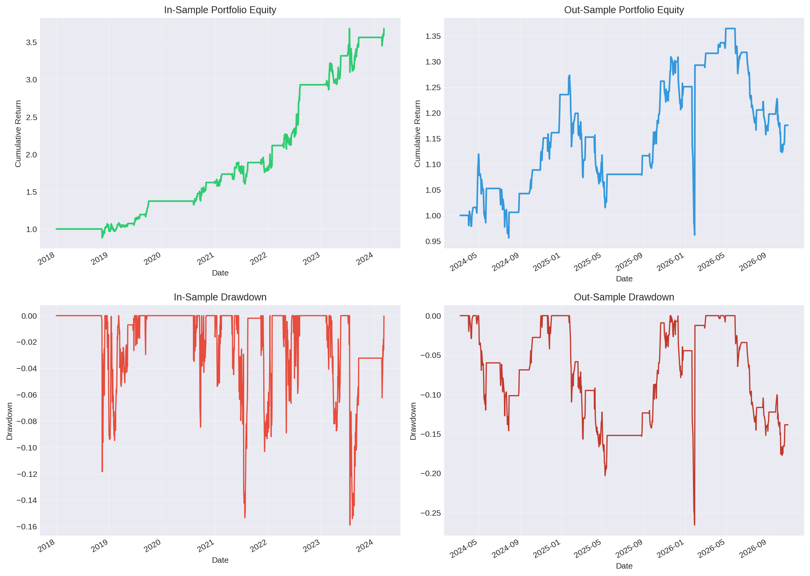
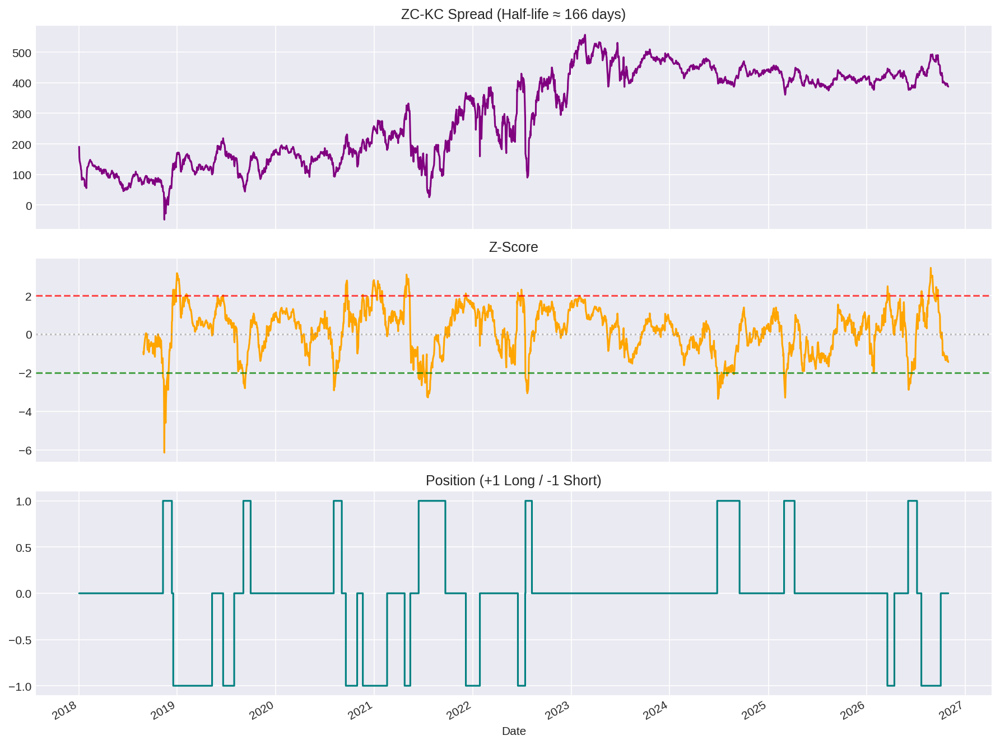

# kalman-pairs

Minimalist Kalman Filter pairs trading on commodity futures using **yfinance** data.

Adapted from the [QuantInsti EPAT blog](https://blog.quantinsti.com/kalman-filter-techniques-statistical-arbitrage-china-futures-market-python/) on statistical arbitrage in China’s futures market. This version replaces proprietary Chinese futures data with publicly available liquid commodity futures and adds an updated notebook with executed outputs.

## Idea

1. Download daily closes for liquid commodity futures via `yfinance`.
2. Screen for cointegrated pairs (Engle-Granger / ADF).
3. Estimate **dynamic hedge ratios** with a Kalman Filter regression.
4. Compute the half-life of mean reversion on the spread.
5. Generate z-score signals using a rolling window equal to the half-life.
6. Trade ±2 entry / 0 exit. Equal-weight the surviving pairs into a portfolio.

## Data

| Symbol | Instrument       |
|--------|------------------|
| CL     | WTI Crude        |
| BZ     | Brent Crude      |
| GC     | Gold             |
| SI     | Silver           |
| HG     | Copper           |
| NG     | Natural Gas      |
| ZC     | Corn             |
| ZS     | Soybeans         |
| KC     | Coffee           |
| CT     | Cotton           |

Period: 2018-01-02 → 2026-10-30 (≈2,223 trading days).

## Results (executed notebook)

**In-sample** (2018-01-02 → 2024-03-07)  
**Out-sample** (2024-03-08 → 2026-10-30)

| Period       | Total Return | CAGR   | Sharpe | Max DD  |
|--------------|--------------|--------|--------|---------|
| In-sample    | +268%        | 23.5%  | 1.15   | -15.9%  |
| Out-sample   | +17.6%       | 6.3%   | 0.34   | -26.6%  |

Only one pair (ZC-KC) cleared the filters (Sharpe > 0.8 and CAGR > 5%) on the training window. Results are shown without transaction costs or slippage.

### Portfolio equity & drawdowns



### Example pair detail (ZC–KC)



## Notebook

`kalman_pairs_executed.ipynb` contains the full pipeline with all cells executed and outputs (including charts) saved.

## Quick start

```bash
pip install -r requirements.txt
jupyter notebook kalman_pairs_executed.ipynb
```

## Notes

- Kalman Filter provides a continuously updated hedge ratio without a fixed lookback.
- Half-life is used both as a tradability filter and as the rolling window for z-score calculation.
- Cointegration is re-tested on the full sample; in a live system it should be monitored continuously.
- No costs modeled. Real implementation would need realistic commission, slippage, and contract roll handling.

## License

MIT
